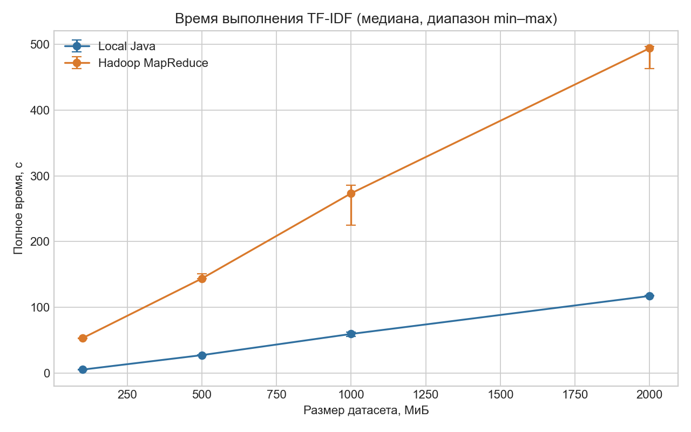
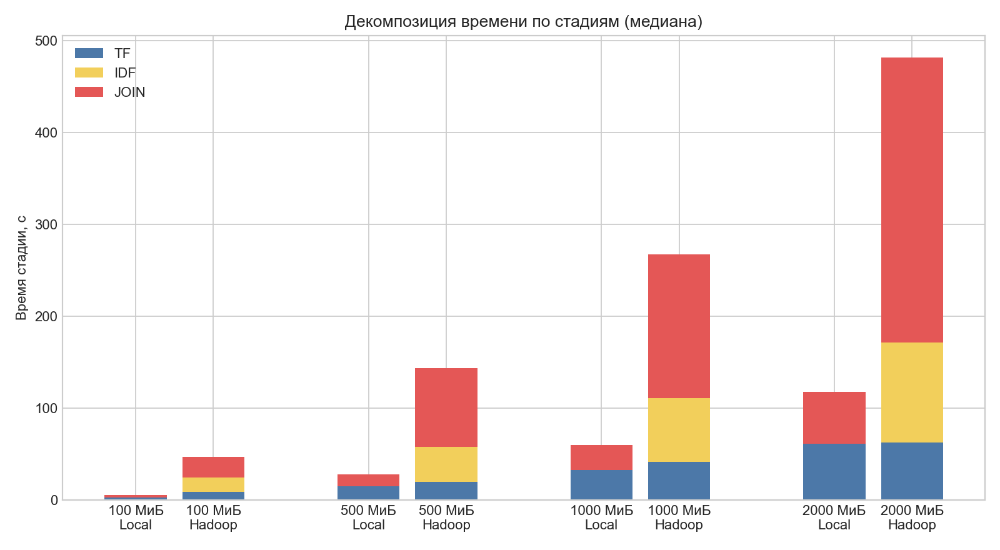

# Вычисление TF-IDF с использованием Hadoop MapReduce

## 1. Цель работы

Цель работы — изучить принципы распределённого хранения и обработки данных в Apache Hadoop на примере вычисления TF-IDF для текстового корпуса FineWeb-Edu. Для этого алгоритм разбит на три последовательных задания MapReduce, использующих HDFS и YARN.

Дополнительная задача работы — сравнить время выполнения распределённого варианта с однопоточной реализацией на Java. Такое сравнение позволяет увидеть не только возможный выигрыш от параллельной обработки, но и накладные расходы Hadoop на запуск заданий, передачу промежуточных данных и сортировку.

## 2. Теоретические сведения

### 2.1. Алгоритм TF-IDF

TF-IDF (Term Frequency — Inverse Document Frequency) — численная оценка значимости слова для конкретного документа внутри корпуса. Метод применяется в информационном поиске, ранжировании документов, выделении ключевых слов и подготовке признаков для моделей обработки текста.

Частота терма показывает, какую долю слов документа составляет терм $t$:

$$
TF(t,d)=\frac{count(t,d)}{|d|},
$$

где $count(t,d)$ — число появлений терма $t$ в документе $d$, а $|d|$ — общее число токенов в документе.

Обратная документная частота уменьшает вес слов, встречающихся во многих документах:

$$
IDF(t)=\ln\left(\frac{N}{df(t)}\right),
$$

где $N$ — число документов в корпусе, а $df(t)$ — число документов, содержащих терм $t$ хотя бы один раз.

Итоговый вес равен произведению двух величин:

$$
TF\text{-}IDF(t,d)=TF(t,d)\cdot IDF(t).
$$

Высокое значение получается у слова, которое часто встречается в выбранном документе, но редко — в остальных документах корпуса.

### 2.2. Принцип работы Hadoop MapReduce

Hadoop разделяет хранение данных и управление вычислениями между двумя подсистемами: HDFS и YARN.

**HDFS.** Файл в HDFS разбивается на крупные блоки; в данной конфигурации размер блока равен 128 Мб. Содержимое блоков хранится на DataNode. NameNode хранит только метаданные файловой системы: имена и структуру каталогов, права доступа, список блоков каждого файла и сведения о DataNode, на которых находятся реплики. Само содержимое всех пользовательских файлов NameNode не хранит.

Когда клиент читает файл, он сначала запрашивает у NameNode расположение нужных блоков, а затем получает данные непосредственно от DataNode. DataNode периодически отправляют NameNode сигналы состояния и отчёты о блоках. При записи NameNode выбирает узлы для размещения блоков, а поток данных передаётся между клиентом и DataNode

Для защиты от отказа отдельного узла HDFS создаёт несколько реплик каждого блока. Если коэффициент репликации равен 3, нормальный блок хранится в трёх экземплярах на разных DataNode. NameNode контролирует число доступных реплик и при необходимости планирует восстановление недостающих копий.

**YARN.** ResourceManager принимает приложения и распределяет ресурсы кластера. Для отдельного MapReduce-приложения запускается ApplicationMaster: он запрашивает контейнеры для задач и следит за их выполнением. NodeManager работает на вычислительном узле, запускает назначенные ему контейнеры и сообщает об их состоянии. Следовательно, ResourceManager координирует вычисления, но не хранит блоки HDFS и не выполняет пользовательские Mapper и Reducer самостоятельно

В модели MapReduce вход разбивается на части, которые обрабатывают Mapper. Mapper преобразует входные пары «ключ — значение» в промежуточные пары. Затем начинается **Shuffle and Sort**: промежуточные записи распределяются по reducer, передаются на нужные узлы, сортируются и группируются по ключу. Reducer получает ключ и все относящиеся к нему значения, выполняет агрегацию и записывает результат.

Планировщик старается запустить Map Task на узле, где уже находится нужный блок HDFS, или как можно ближе к нему. Такой принцип называется локальностью данных. Для больших объёмов выгоднее переместить небольшой исполняемый код к данным, чем многократно передавать исходный файл по сети. Если локального контейнера нет, задача может быть запущена на другом узле и прочитать блок удалённо.

### 2.3. Реализация TF-IDF через MapReduce

Распределённое вычисление состоит из трёх последовательных Job.

#### Job 1 — вычисление TF

Mapper получает одну строку TSV, выделяет идентификатор и текст документа, выполняет токенизацию и подсчитывает частоты слов в пределах документа. Для каждой уникальной пары «документ — слово» он вычисляет нормализованный TF и записывает результат вида:

```text
documentId:word    tf
```

Это Map-only задание: Reducer не используется, поскольку все данные для TF одного документа уже доступны одному вызову Mapper. Результат записывается в HDFS и одновременно служит входом для следующих двух Job.

#### Job 2 — вычисление IDF

Mapper читает TF-записи и для каждой пары «документ — слово» выдаёт `(word, 1)`. В результате единица означает присутствие слова в одном документе, так как Job 1 создаёт не более одной TF-записи для слова в документе.

Combiner локально складывает единицы с одинаковым словом до отправки данных по сети. Например, пять записей `(hadoop, 1)` от одного Mapper превращаются в `(hadoop, 5)`. Это не меняет итоговую сумму, но уменьшает число промежуточных значений, передаваемых на Shuffle.

После Shuffle все частичные суммы одного слова попадают к одному Reducer. Он вычисляет $df(t)$, а затем $IDF(t)=\ln(N/df(t))$, где $N$ получено из счётчика обработанных документов Job 1. Результат имеет вид `word<TAB>idf`.

#### Job 3 — объединение TF и IDF

Третий Job выполняет Reduce-side Join. TF и IDF читаются разными Mapper с помощью двух входов. Оба Mapper формируют составной ключ `JoinKey(word, recordType)`, где тип различает IDF- и TF-записи. Например:

```text
(hadoop, IDF) -> 0.693
(hadoop, TF)  -> doc-1<TAB>0.50
(hadoop, TF)  -> doc-2<TAB>0.25
```

Здесь применён Secondary Sort:

- `JoinKey` сначала сравнивает слово, затем тип записи; тип IDF имеет меньший код, поэтому IDF сортируется раньше TF
- `JoinPartitioner` выбирает reducer только по слову, поэтому все данные одного слова попадают в одну секцию
- `JoinGroupingComparator` группирует записи только по слову, поэтому reducer получает IDF и все TF этого слова в одном вызове

Reducer сначала считывает IDF, а затем последовательно умножает на него поступающие значения TF. В первоначальном варианте все TF-записи слова накапливались в `ArrayList`. Для распространённых слов это могло требовать много памяти. Secondary Sort устраняет такое накопление: после первой IDF-записи поток TF можно обрабатывать по одной записи

## 3. Практическая реализация

Проект написан на Java и собирается с помощью Gradle. Для распределённой версии используются Apache Hadoop 3.5.0, HDFS и YARN; сервисы запускаются через Docker Compose.

| Роль | Количество | Назначение |
|---|---:|---|
| NameNode | 1 | метаданные HDFS |
| DataNode | 3 | хранение блоков HDFS |
| ResourceManager | 1 | распределение ресурсов YARN |
| NodeManager | 3 | запуск контейнеров с задачами |
| HistoryServer | 1 | история выполненных MapReduce Job |

Все контейнеры работали на одном MacBook Air с Apple M5, 10 ядрами CPU и 16 ГиБ RAM. Такая конфигурация воспроизводит роли Hadoop и позволяет изучить распределение блоков и задач, однако не является полноценным кластером из независимых физических серверов. Виртуальные узлы используют общие CPU, оперативную память и SSD.

Для сравнения реализован локальный однопоточный вариант на Java. Он использует тот же `Tokenizer` и те же формулы, последовательно вычисляет TF, IDF и TF-IDF, сохраняет промежуточные TSV-файлы и держит словарь значений DF/IDF в памяти. Поэтому различия результатов не связаны с другой токенизацией или математикой.

## 4. Экспериментальное исследование

### 4.1. Подготовка данных

FineWeb-Edu — англоязычный текстовый корпус образовательных веб-страниц, полученный фильтрацией исходного корпуса FineWeb с помощью классификатора качества. В работе использован файл [`sample/10BT/000_00000.parquet`](https://huggingface.co/datasets/HuggingFaceFW/fineweb-edu/blob/main/sample/10BT/000_00000.parquet) из репозитория датасета на Hugging Face. Он относится к случайной выборке `sample-10BT`, содержащей около 10 млрд токенов в токенизации GPT-2; размер исходного Parquet-файла на Hugging Face составляет 2,15 ГБ.

Сценарий [`scripts/prepare_dataset.py`](scripts/prepare_dataset.py) считывал из Parquet поля `id` и `text`, удалял пустые документы и переносы строк внутри текста, после чего записывал каждый документ в отдельную строку TSV-формата:

```text
documentId<TAB>text
```

Использовались четыре фиксированные выборки:

| Метка | Файл | Фактический размер, байт |
|---:|---|---:|
| 100 Мб | `fineweb-100mb.tsv` | 104 856 796 |
| 500 Мб | `fineweb-500mb.tsv` | 524 287 150 |
| 1000 Мб | `fineweb-1gb.tsv` | 1 073 738 702 |
| 2000 Мб | `fineweb-2gb.tsv` | 2 147 483 020 |

Полный корпус объёмом 3,3 ГБ не включался в итоговое сравнение из-за высокой продолжительности обработки на доступном оборудовании. Параметры среды и контрольные суммы файлов сохранены в [`benchmark/results/environment.json`](benchmark/results/environment.json).

### 4.2. Методика эксперимента

Для каждого размера выполнено по три успешных запуска Local Java и Hadoop MapReduce. Запуски выполнялись последовательно, чтобы две реализации не конкурировали друг с другом одновременно. Измерялось полное время: для локальной версии — от запуска Java-процесса до записи результата, для Hadoop — от запуска pipeline до завершения третьего Job.

В качестве итогового времени использовалась медиана трёх запусков. Производительность рассчитывалась по фактическому размеру файла в Мб, делённому на медианное время в секундах. Ускорение Hadoop определялось формулой:

$$
S=\frac{T_{local}}{T_{hadoop}}.
$$

Если $S>1$, Hadoop выполнил обработку быстрее; если $S<1$, быстрее была локальная реализация. Сводные измерения доступны в [`summary.csv`](benchmark/results/summary.csv) и [`summary.json`](benchmark/results/summary.json).

### 4.3. Результаты

| Размер данных | Local Java, с | Hadoop, с | Ускорение $S$ |
|---:|---:|---:|---:|
| 100 Мб | 5,57 | 53,35 | 0,104× |
| 500 Мб | 27,59 | 143,99 | 0,192× |
| 1000 Мб | 59,78 | 273,46 | 0,219× |
| 2000 Мб | 117,50 | 493,92 | 0,238× |

Медианное время отдельных этапов:

| Размер | Реализация | TF, с | IDF, с | Join, с |
|---:|---|---:|---:|---:|
| 100 Мб | Local Java | 2,872 | 0,029 | 2,582 |
| 100 Мб | Hadoop | 8,609 | 16,079 | 22,155 |
| 500 Мб | Local Java | 14,584 | 0,087 | 12,818 |
| 500 Мб | Hadoop | 19,657 | 37,985 | 85,752 |
| 1000 Мб | Local Java | 32,365 | 0,140 | 27,148 |
| 1000 Мб | Hadoop | 41,212 | 69,347 | 156,425 |
| 2000 Мб | Local Java | 60,841 | 0,213 | 56,378 |
| 2000 Мб | Hadoop | 62,251 | 108,754 | 310,507 |





### 4.4. Анализ результатов

На всех четырёх выборках Local Java оказалась быстрее Hadoop. Hadoop потребовал примерно в 9,58 раза больше времени на 100 Мб, в 5,22 раза — на 500 Мб, в 4,57 раза — на 1000 Мб и в 4,20 раза — на 2000 Мб. При этом относительный разрыв с ростом входа сокращался: производительность Hadoop выросла с 1,87 до 4,15 Мб/с, поскольку постоянные расходы запуска трёх YARN-приложений распределялись на больший объём данных. Производительность локальной версии оставалась около 17–18 Мб/с.

Основные накладные расходы Hadoop связаны с запуском Job, материализацией промежуточных результатов в HDFS, Shuffle and Sort и синхронизацией распределённых задач. Самым дорогим этапом был Reduce-side Join: его медианное время выросло с 22,155 с на 100 Мб до 310,507 с на 2000 Мб. Объём Shuffle при этом вырос с 527 469 657 до 10 763 251 053 байт.

Hadoop также многократно читает и записывает промежуточные данные. Для серии 2000 Мб суммарные счётчики трёх Job показывают 22 615 314 607 байт чтения из HDFS и 20 450 693 335 байт записи при размере исходного файла 2 147 483 020 байт. Локальная программа повторно читает промежуточный TF-файл, но не выполняет сетевой Shuffle и хранит DF/IDF в памяти.

Полученный результат не означает, что Hadoop в целом хуже однопоточной Java-программы. В эксперименте три виртуальных рабочих узла конкурировали за один SSD, один процессор и общую память. Hadoop рассчитан на объёмы, которые распределяются между независимыми машинами; такая конфигурация может обеспечить параллелизм, совокупную пропускную способность дисков и отказоустойчивость, которых нет на одной машине

## 5. Проверка корректности

Результаты Local Java и Hadoop сравнивались по составному ключу `documentId:word` и числовому значению TF-IDF. Порядок строк не учитывался: оба набора проходили внешнюю сортировку, после чего сопоставлялись потоково без загрузки всех записей в память. Допустимая абсолютная погрешность составляла $10^{-9}$; пропущенных ключей и расхождений значений не обнаружено.

| Размер | Обработано документов | Проверено TF-IDF-записей |
|---:|---:|---:|
| 100 Мб | 21 363 | 6 501 501 |
| 500 Мб | 107 849 | 32 539 101 |
| 1000 Мб | 222 698 | 66 908 036 |
| 2000 Мб | 445 226 | 133 749 894 |

Подробные результаты проверки: [`100mb.json`](benchmark/results/validation/100mb.json), [`500mb.json`](benchmark/results/validation/500mb.json), [`1000mb.json`](benchmark/results/validation/1000mb.json), [`2000mb.json`](benchmark/results/validation/2000mb.json).

## 6. Выводы

В ходе работы была изучена архитектуруа YARN и реализовал распределённое вычисление TF-IDF в виде трёх MapReduce Job: Map-only расчёта TF, расчёта IDF с Combiner и Reduce-side Join. На практике были рассмотрены Shuffle and Sort, составные ключи, собственный Partitioner и Secondary Sort, позволивший обрабатывать TF-записи потоком без накопления большого списка в памяти

Сравнение показало, что на использованной машине однопоточная Java-реализация быстрее для всех исследованных выборок, хотя относительный разрыв уменьшался при росте данных. Этот результат нельзя напрямую переносить на кластер из независимых серверов: в учебной конфигурации все контейнеры конкурировали за одни аппаратные ресурсы.

## 7. Запуск проекта

1. Запустить Hadoop-кластер:

   ```bash
   docker compose up -d
   ```

2. Собрать Java-проект:

   ```bash
   ./gradlew clean test jar --no-daemon
   ```

3. Загрузить подготовленные выборки в HDFS и скопировать JAR в контейнер NameNode:

   ```bash
   benchmark/scripts/prepare_hdfs.sh
   ```

4. Запустить Hadoop pipeline, указав три ещё не существующих выходных каталога:

   ```bash
   docker compose exec -T namenode \
     hadoop jar /tmp/tfidf-benchmark.jar \
     /input/tfidf/benchmark/fineweb-100mb.tsv \
     /output/manual/tf /output/manual/idf /output/manual/tfidf
   ```

5. Запустить локальную реализацию:

   ```bash
   java -Xmx4g \
     -cp build/libs/hadoop-tfidf-1.0.0.jar \
     ru.lab.tfidf.local.LocalTfidfMain \
     --input data/samples/fineweb-100mb.tsv \
     --output /tmp/tfidf-local-output
   ```

6. При необходимости выполнить серию измерений существующим сценарием:

   ```bash
   benchmark/scripts/run_benchmark.sh \
     --repetitions 3 \
     --sizes "100 500 1000 2000" \
     --implementation both
   ```

Сценарии не перезаписывают уже успешно сохранённые результаты. Перед полным повтором эксперимента необходимо убедиться, что на диске достаточно места для входных, промежуточных и выходных данных.
